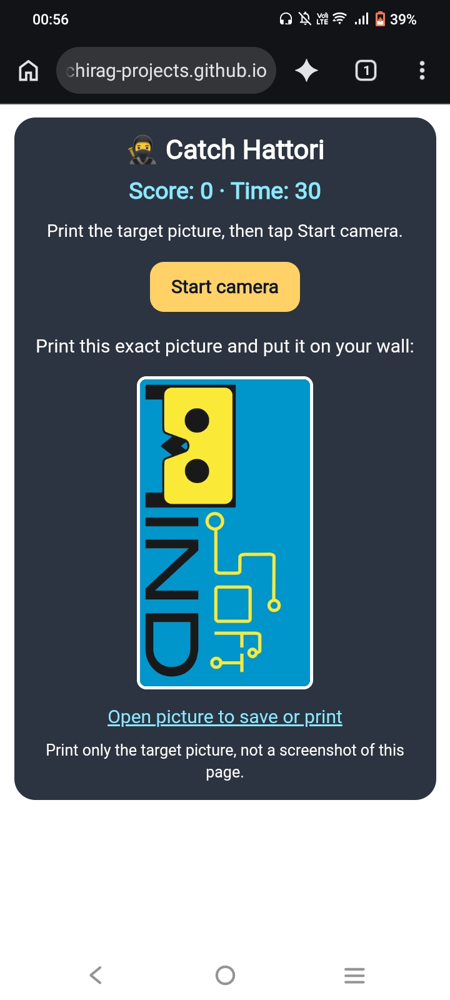
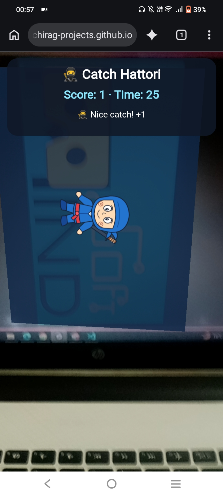

# 🥷 Catch Hattori — AR Ninja Game

**Find the target. Catch the ninja. Beat your score.**

Catch Hattori is a mobile-friendly augmented reality game that brings a cartoon ninja into your phone’s camera view. Point your camera at the target image, watch Hattori appear, and tap him before he moves!

Built with **MindAR, A-Frame, and JavaScript**, the game runs in a browser without requiring an APK or Google Play Services for AR.

> **Image-tracked AR:** The game needs the provided target picture. It does not detect or attach content to a blank wall.

---

## 📸 Preview

<p align="center">
  
  &nbsp;
  
</p>

---

## ✨ Features

- 📷 **Live camera AR** — Hattori appears over a recognized target image.
- 👆 **Tap-to-catch gameplay** — earn one point for every successful catch.
- 🎲 **Random movement** — Hattori jumps between five positions.
- ⏱️ **30-second challenge** — catch as many ninjas as you can.
- ⏸️ **Tracking-aware timer** — gameplay pauses when the target leaves view.
- 💤 **Background pause** — the timer pauses when the browser tab is hidden.
- 🏆 **Final ranks** — finish as a Ninja Beginner, Ninja, or Ninja Master.
- 🔄 **Replay button** — start another round without reloading.
- 📱 **Touch controls** — direct raycasting checks taps against the character.

---

## 🎮 How to Play

1. Open the hosted game on your phone.
2. Print the target image below, or display it on another screen.
3. Tap **Start camera**.
4. Allow camera access.
5. Point your phone at the target.
6. Once Hattori appears, tap him to earn points.
7. Keep catching him until the timer reaches zero.
8. Tap **Play again** to try for a higher score.

### Scoring

| Successful catches | Rank |
| --- | --- |
| 0–9 | 🥷 Ninja Beginner |
| 10–19 | ⚔️ Ninja |
| 20+ | 🏆 Ninja Master |

**Each successful catch earns +1 point. Missed taps do not deduct points.**

---

## 🖼️ Tracking Target

Use this exact target picture:

<p align="center">
  
</p>

**[Open the target image](media/mind_ar.jpeg)** to save or print it.

### Tips for better tracking

- Keep the entire target visible.
- Use even lighting and avoid strong glare.
- Keep a printed target flat.
- Move your phone slowly while finding the target.
- If using another screen, avoid reflections and extreme brightness.

> The artwork must match the compiled target data used by the game. Replacing the target picture alone will not create a new tracking target.

---

## 🛠️ Tech Stack

| Technology | Purpose |
| --- | --- |
| HTML | Page structure and AR scene |
| CSS | Mobile interface and styling |
| JavaScript | Scoring, timing, movement, and input |
| MindAR | Camera-based image tracking |
| A-Frame | Declarative AR scene |
| Three.js through A-Frame | Raycasting for tap detection |
| SVG | Hattori character artwork |
| GitHub Pages | Static website hosting |

---

## 📂 Project Structure

```text
Ninja_Catch_Game/
├── index.html
├── hattori.svg
├── README.md
└── media/
    ├── gameplay.jpg
    ├── target.jpg
    └── start-screen.jpg
```

The current implementation loads its JavaScript libraries and compiled sample tracking target from CDNs. The files in `media/` document the project; they do not automatically change the target configured in `index.html`.

---

## 🚀 Run the Project

### 1. Clone the repository

Copy your repository’s HTTPS clone URL from GitHub, then run:

```bash
git clone YOUR_REPOSITORY_URL
cd YOUR_REPOSITORY_FOLDER
```

Replace the placeholders with your repository URL and folder name.

### 2. Start a local server

If Python is installed:

```bash
python -m http.server 8000
```

Open this address on the same computer:

```text
http://localhost:8000
```

No package installation or build step is required.

### 3. Test on your phone

For phone testing, publish the project on an **HTTPS website**, such as GitHub Pages.

Do not open `index.html` directly from your phone’s file manager. An ordinary HTTP address served from your computer’s local network may also be blocked from accessing the camera.

---

## 🌐 Deploy with GitHub Pages

1. Push the project files to GitHub.
2. Open the repository’s **Settings → Pages**.
3. Choose **Deploy from a branch**.
4. Select **main** and **/ (root)**.
5. Save and wait for deployment.
6. Open the published HTTPS address on your phone.

Keep `index.html` and `hattori.svg` in the root of the publishing folder.

---
---

## 🔮 Future Ideas

- ⭐ Collectible bonus stars
- 💨 Smoke-bomb obstacles
- 🔊 Optional sound effects
- 📈 Difficulty levels
- 🥇 Personal best saved locally
- 🎨 Custom target posters
- 🥷 Additional characters and animations

These are planned ideas, not current features.

---

## 🙌 Credits

- **MindAR** — image-tracking framework and sample target artwork.
- **A-Frame and Three.js** — rendering and interaction tools.
- **Ninja Hattori** — character inspiration.

This is an unofficial fan-made learning project and is not affiliated with the Ninja Hattori rights holders. Third-party libraries and assets retain their respective ownership and license terms.

---
## 📸 Game Preview

### 1. Start Screen

Open the game on your phone and tap **Start camera**, then allow
camera access.

<p align="center">
  
</p>

### 2. Game in Action

Point your camera at the target image. Hattori appears over it!
Tap him to earn **+1 point** before he moves.

Catch as many times as you can during the **30-second challenge**.
The timer pauses when the target leaves view.

<p align="center">
  
</p>

### 3. Image You Need to Scan

**Scan this exact picture—not the start-screen or gameplay screenshot.**

Print it and attach it to a wall, or display it on another device.
Keep the entire picture visible to your phone’s camera.

<p align="center">
  <a href="./media/mind-ar.jpeg">
    <strong>🖼️ Open the target image to save or print</strong>
  </a>
</p>

> This game tracks the target picture, not a blank wall.
> The picture must match the tracking target configured in the game.

<p align="center">
  <strong>Point. Track. Tap. Become a Ninja Master! 🥷</strong>
</p>